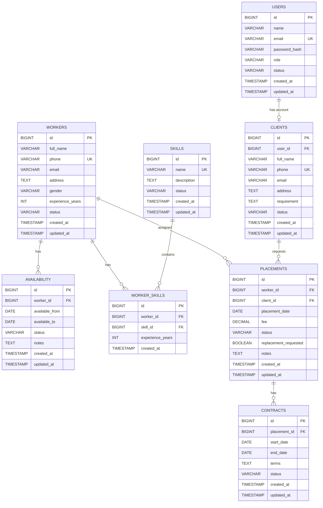

# ER Diagram

## Main Entities

- Users
- Workers
- Clients
- Skills
- Worker_Skills
- Availability
- Placements
- Contracts

## Relationships

Users
    |
    | 1 : 0..1
    |
Clients

Workers
    |
    | 1 : Many
    |
Availability

Workers
    |
    | Many : Many
    |
Worker_Skills
    |
    | Many : 1
    |
Skills

Workers
    |
    | 1 : Many
    |
Placements
    |
    | Many : 1
    |
Clients

Placements
    |
    | 1 : Many
    |
Contracts
## Relationship Summary

1. One User can be associated with one Client account.
2. One Worker can have multiple Availability records.
3. Workers and Skills have a many-to-many relationship through Worker_Skills.
4. One Worker can have multiple Placements.
5. One Client can have multiple Placements.
6. A Placement can have Contract records.
## Visual ER Diagram

